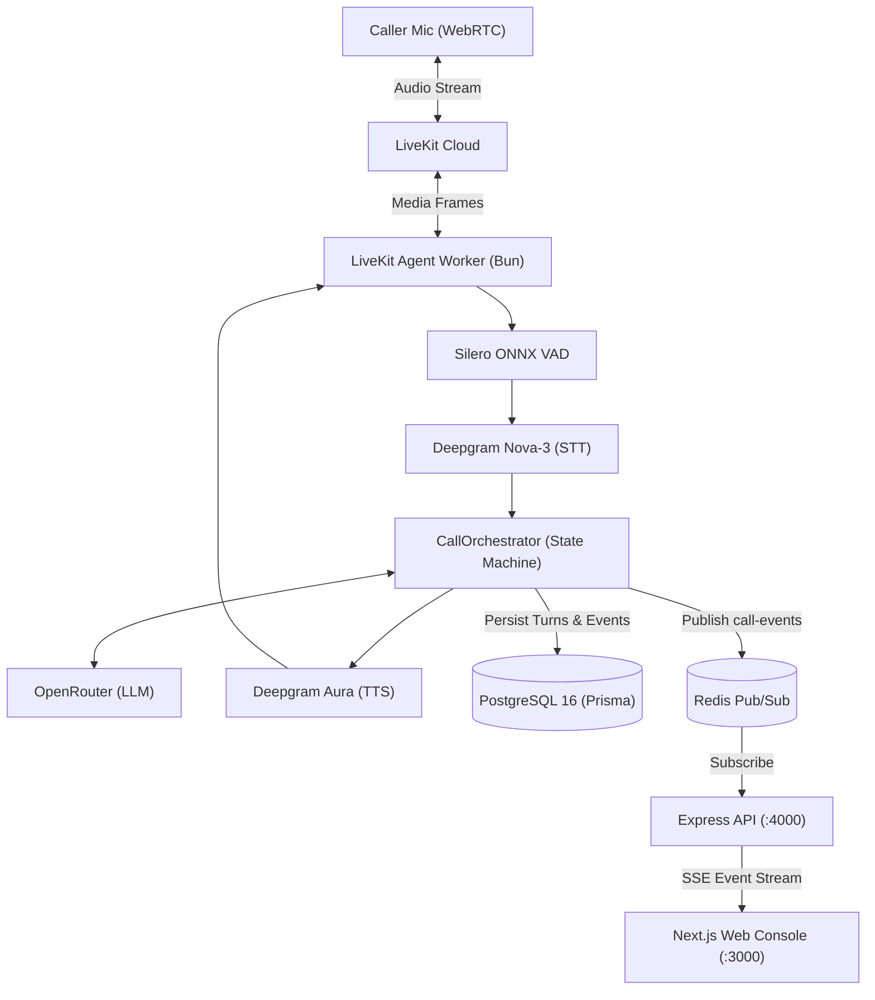

# Laura Voice

Real-time conversational voice AI intake agent with deterministic qualification and live telemetry.

[](https://www.typescriptlang.org/)
[](https://livekit.io/)
[](https://deepgram.com/)
[](https://nextjs.org/)

## Overview

High-intent customer intake—such as legal claim qualification—demands conversational fluidity without sacrificing deterministic business rules. Laura Voice is an end-to-end voice AI system where callers interact in real time via browser WebRTC. It pairs a low-latency speech pipeline with a strict state machine that separates conversational reasoning from deterministic qualification logic, streaming live telemetry to an operator console.

<!-- TODO: add 60-second voice interaction demo video / GIF here -->

## Key Features

- **Cascaded Speech Pipeline:** LiveKit Cloud WebRTC media transport integrating Deepgram Nova-3 streaming STT, OpenRouter LLM inference, and Deepgram Aura streaming TTS.
- **Barge-in with False-Interruption Filtering:** Prewarmed local Silero ONNX VAD configured with a 2-word transcription threshold to instantly cancel agent speech on user interruption while ignoring coughs and background noise.
- **Deterministic 9-Phase State Machine:** Explicit transitions orchestrating 4 specialized agents (Triage, Intake, Qualification, Scheduling), validating all handoff edges in code.
- **Code-Enforced Qualification:** Pure TypeScript business logic evaluating claim viability; the LLM gathers facts but never decides qualification status.
- **Decoupled Asynchronous Fact Extraction:** Extracts structured JSON facts into validated Zod schemas in the background without delaying spoken turns.
- **Idempotent Appointment Scheduling:** Consultation booking keyed by compound call and request identifiers to eliminate double-booking on retry.
- **Sub-Turn Latency Observability:** Real-time collection of TTFT, TTFB, and end-of-utterance delay metrics persisted to PostgreSQL.
- **Live Operator Console:** Next.js web dashboard streaming transcripts, extracted case facts, and latency timelines via Server-Sent Events (SSE).

## Architecture

Laura Voice runs an event-driven worker connected to LiveKit Cloud. Incoming audio frames are processed by Silero VAD and Deepgram STT. Spoken turns feed the active agent inside `CallOrchestrator`. When facts are collected, background tasks extract structured entities while the conversational turn completes. All events and latency timestamps publish to Redis Pub/Sub, which an Express API forwards to the Next.js web client via Server-Sent Events.



### Key Design Decisions
- **The LLM Proposes, Code Decides:** Agents invoke tools to suggest handoffs, but `CallOrchestrator` validates every edge against `PHASE_TRANSITIONS`, preventing non-deterministic workflow jumps.
- **Prewarmed Local VAD:** Silero ONNX loads once on worker startup rather than per call, eliminating cold-start speech detection latency.
- **Audio Teardown Grace Period:** Call termination waits up to 15 seconds for the agent's spoken goodbye to complete playing before closing the WebRTC room.
- **Server-Sent Events over Polling:** Real-time operator dashboard updates instantaneously off Redis pub/sub without database polling.

## Tech Stack

| Domain | Technologies |
| :--- | :--- |
| **Voice & Media** | LiveKit Cloud, LiveKit Agents SDK, Silero VAD (ONNX), Deepgram Nova-3 & Aura |
| **Agent Core** | TypeScript, Bun, OpenRouter API (Llama 3.3 70B), Zod schema validation |
| **Backend API** | Express, Redis Pub/Sub, Prisma ORM, Server-Sent Events (SSE) |
| **Frontend** | Next.js 15, React 19, Tailwind CSS, Lucide Icons |
| **Data & Infra** | PostgreSQL 16 (6 Prisma models), Redis 7, Docker, Turborepo |

## Getting Started

### Prerequisites
- [Bun](https://bun.sh/) $\ge$ 1.3
- [Docker](https://www.docker.com/) and Docker Compose
- API Keys: LiveKit Cloud, Deepgram, and OpenRouter

### Local Setup
```bash
# 1. Clone repository
git clone https://github.com/chill-czar/laura-voice.git
cd laura-voice

# 2. Configure environment
cp .env.example .env
# Edit .env and supply: LIVEKIT_URL, LIVEKIT_API_KEY, LIVEKIT_API_SECRET,
# DEEPGRAM_API_KEY, OPENROUTER_API_KEY

# 3. Start local Postgres and Redis
docker compose up -d postgres redis

# 4. Install dependencies and seed demo data
bun install
bun run db:migrate
bun run db:seed

# 5. Start all services (web :3000, api :4000, agent worker)
bun run dev
```

Open `http://localhost:3000`, click **Start Call**, allow microphone access, and speak with the intake agent.

## Project Structure

```
laura-voice/
├── apps/
│   ├── agent/                  # LiveKit agent worker daemon, voice pipeline, state machine
│   │   ├── src/agents/         # Specialized agents (Triage, Intake, Qualification, Scheduling)
│   │   ├── src/orchestrator/   # CallOrchestrator, CallState, and ContextService
│   │   └── src/services/       # CaseService, AppointmentService, EventService, OpenRouter
│   ├── api/                    # Express server (LiveKit token minting, SSE event streaming)
│   └── web/                    # Next.js 15 operator console and historical call visualizer
├── packages/
│   ├── db/                     # Prisma schema (Caller, Matter, Call, Turn, Event) and seed
│   └── shared/                 # Zod schemas, phase state-machine graph, and shared contracts
└── docker-compose.yml          # Local container definitions for PostgreSQL and Redis
```

## Status & Roadmap

**Current Status:** Working portfolio prototype. Runs locally via Docker Compose and Bun; no public production deployment.

- [ ] Implement automated evaluation harness executing 20–30 scripted audio test conversations.
- [ ] Add automated unit tests for state machine edge transitions and qualification logic.
- [ ] Integrate LiveKit semantic turn-detector plugin to complement audio-energy VAD.
- [ ] Deploy public multi-tenant demo on containerized cloud infrastructure.

## Links & Contact

- **Portfolio:** [itsmesarthak.site](https://www.itsmesarthak.site/)
- **GitHub:** [@chill-czar](https://github.com/chill-czar)
- **LinkedIn:** [Sarthak Chaudhari](https://www.linkedin.com/in/its-sarthak-chaudhari/)
- **Email:** [aisarthak2@gmail.com](mailto:aisarthak2@gmail.com)
